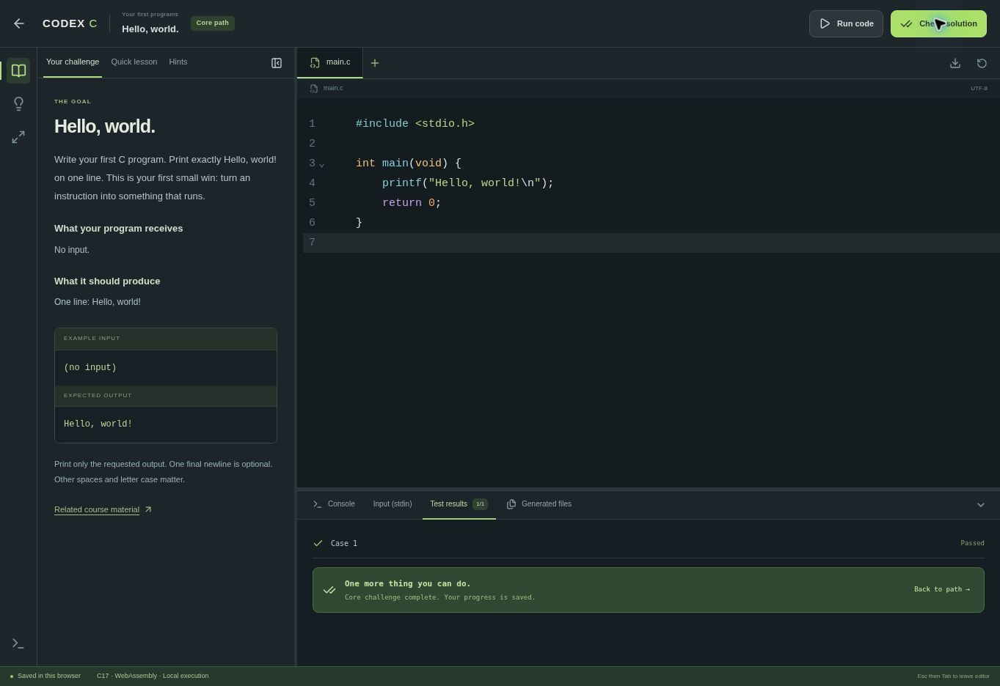

# CODEX C

**Small steps. Real programs.** A browser-based C learning space for classes and independent practice, created for SLAKER’s teaching workflow.

CODEX C combines a guided learning path with short lessons, runnable examples, core challenges, harder gold extensions, optional practice, and project workspaces. It is a static application designed for GitHub Pages: student code compiles and runs in the browser, and progress stays on the student’s device.

## Start here

- [Open the classroom preview](https://s-l-a-k-e-r.github.io/CODEX_C/)
- [Complete product and teaching specification](docs/PRODUCT_SPECIFICATION.md)
- [Architecture and runtime limits](docs/ARCHITECTURE.md)
- [Add or review course content](docs/CONTENT_AUTHORING.md)
- [Testing and release checklist](docs/TESTING.md)
- [Roadmap](docs/ROADMAP.md)



## Classroom preview 0.1

- 15 short lessons with complete runnable examples.
- 60 challenges: 30 core, 15 gold second parts, and 15 optional exercises.
- A selectable path, searchable exercise library, and three milestone-based projects.
- Full-page CodeMirror editor with highlighting, paired brackets/quotes, indentation, search, folding, undo/redo, and compiler diagnostics.
- Real C17 compilation with Clang, a WebAssembly linker, and WASI execution in a worker.
- Multiple source/header files, prepared standard input, generated text files, stop control, and execution limits.
- Local profile, activity heatmap, chapter progress, focused-time estimates, full backup export/import, and summary export.

This is an owner-review preview, not the completed full-year curriculum. Automatic Drive synchronisation, a full C debugger, secure grading, a newer C23 compiler, and native operating-system features are not implemented. [The specification](docs/PRODUCT_SPECIFICATION.md) separates implemented and planned features.

## Run locally

Use Node.js 24 LTS (or a compatible Node version >=22.12) and npm:

```sh
npm ci
npm run runtime:fetch
npm run dev
```

`runtime:fetch` downloads three pinned assets (about 53 MB total) and checks their SHA-256 hashes. They are ignored by Git and included in the static build. They are served from your site; student code is never sent to a remote compiler.

```sh
npm test
npm run test:curriculum  # Requires GCC; validates all reference solutions
npm run test:runtime     # Uses the actual Clang/WASI toolchain
npm run build
npm run preview
```

## Publish on GitHub Pages

1. In the repository’s **Settings → Pages → Build and deployment**, choose **GitHub Actions** as the source.
2. Run the **Deploy CODEX C** workflow, or push a change to `main` after enabling Pages.
3. Use the URL reported by the successful deployment job. Until that job succeeds, a local build is not a published website.

The build uses relative asset URLs and hash routes, so it works under the repository path. No backend, database, secrets, special isolation headers, or external runtime API is required. CI tests pull requests without deploying them.

## Teaching notes

Give students a direct chapter or challenge link. The path recommends an order, but chapters remain open for classroom use. Gold challenges unlock when their original task is completed. Failed attempts and hints never remove progress.

Program input is entered **before** running. Output tests are visible and compare behaviour; they do not prove use of a particular algorithm or establish understanding. Review code when a pointer, recursion, complexity, ownership, or style requirement matters.

The first run loads the compiler. Try it once before class on the classroom network. Browser storage is not a backup guarantee: students should periodically export a full JSON backup and store it wherever they prefer, including their own cloud drive.

## Credits and rights

Teaching topics and exercise patterns are adapted from [SLAKER’s C course](https://github.com/S-L-A-K-E-R/C_courses), especially the six original general lab sheets. The text, scenarios, tests and interface are newly developed for this project. Excluded institutional and third-party archive material has not been republished.

See [ATTRIBUTION.md](ATTRIBUTION.md) and [THIRD_PARTY_NOTICES.md](THIRD_PARTY_NOTICES.md). This initial contribution does not choose a licence for the owner’s new application code; a repository-wide software licence remains the owner’s decision. Existing third-party licences continue to apply.
