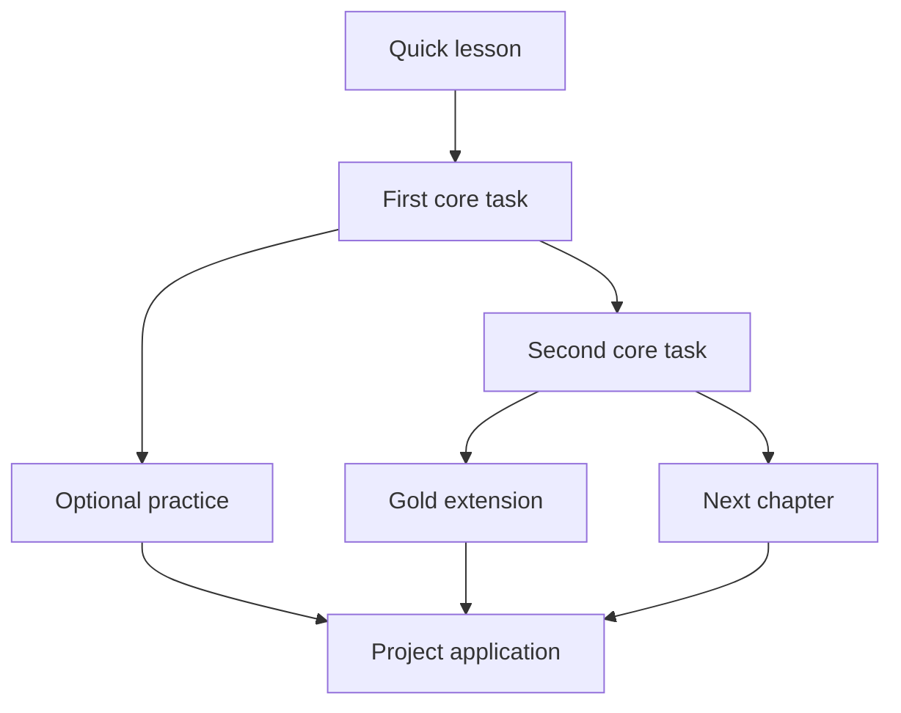

# CODEX C — Product and teaching specification

**Version:** 1.0 · **Date:** 5 November 2026  
**Owner:** SLAKER · **Audience:** C programming students and their teacher  
**Delivery model:** Static website hosted on GitHub Pages

**Document status:** Reviewable product specification with the classroom preview implementation. The recovered source, curriculum, tests and deployment configuration are included in this repository. See [implementation status](IMPLEMENTATION_STATUS.md) for verification and deployment status.

## 1. Purpose

CODEX C helps a student move from “I do not know where to start” to writing, running and explaining a small C program. It replaces the intimidating entry point of a long PDF with short lessons, visible next steps, manageable exercises and immediate feedback. The original course materials remain useful references.

The same platform must give confident students room to explore pointers, memory, advanced strings, structures, modular programs, stacks, queues and optional projects. Students should find direction without being forced into a single pace or daily habit.

The product is a teaching companion. It does not replace teacher feedback, turn test results into proof of understanding, or attempt to reproduce every feature of a desktop IDE.

### Product principles

1. **Make the next step clear.** Every exercise states its goal, inputs, outputs and relevant constraints.
2. **Make starting inexpensive.** Students can edit and run a small program without installing a compiler or creating an account.
3. **Keep coding central.** An exercise opens a full-page workspace with most available space devoted to code.
4. **Reward understanding and exploration.** No daily streak obligation, lost lives, countdown pressure or punishment for using hints.
5. **Keep progress portable.** Browser storage is convenient; exportable backups are essential.
6. **Be honest about limits.** Static hosting, browser C and automatic tests have important boundaries.
7. **Grow quality before quantity.** Each additional exercise needs a learning purpose, reviewed wording and reliable tests.

## 2. Learners and teaching contexts

| Context                           | Need                                            | Product response                                                                              |
| --------------------------------- | ----------------------------------------------- | --------------------------------------------------------------------------------------------- |
| An anxious beginner               | A safe first action and understandable feedback | Short introduction, scaffolded starter, example output, progressive hints                     |
| A student following a class       | The correct chapter or exercise immediately     | Direct links, open chapters and clear core requirements                                       |
| A student who needs more practice | Several approaches to the same concept          | Tracing, repair, completion and independent construction tasks                                |
| A confident student               | Greater depth without waiting for the class     | Gold extensions, optional branches, advanced chapters and projects                            |
| A returning student               | Resume work without remembering where it was    | Saved drafts, last workspace and a suggested next core task                                   |
| The teacher                       | Maintainable material and classroom visibility  | Versioned content, reference solutions, validation scripts and projector-friendly preferences |

The initial writing language is English, with a future EN/FR content structure. A language preference must not change exercise IDs or lose progress. Estimated lesson/exercise durations are not shown. Focused activity time belongs only in the learner's personal history.

## 3. Scope and release boundaries

“Preview” below describes the implemented first application delivery. Later columns define the remaining product scope; they are not claims of completed features.

| Capability          | First classroom preview                                                | Full classroom edition / later work                                              |
| ------------------- | ---------------------------------------------------------------------- | -------------------------------------------------------------------------------- |
| Learning path       | 15 selectable chapters; recommended order; core/gold/optional nodes    | Rich prerequisite metadata and class-specific paths                              |
| Short courses       | 15 concise lessons with runnable examples                              | More explanation, repair tasks, reflection and EN/FR content                     |
| Exercise bank       | 60 tasks: 30 core, 15 gold, 15 optional                                | Approximately 8–12 reviewed tasks per major chapter, adjusted to teaching need   |
| Gold challenges     | Harder second part unlocked by its original task                       | Longer multi-part challenge sequences where useful                               |
| Projects            | Three briefs with four self-assessed milestones each                   | Submission packages, rubrics and larger modular assignments                      |
| Code editor         | Full-page CodeMirror workspace and core IDE conveniences               | Full light/dark preferences, persisted layouts, further accessibility refinement |
| Execution           | Real Clang/WASM/WASI execution, prepared stdin, multiple files         | Newer compiler evaluation, richer terminal interaction if feasible               |
| Feedback            | Compiler diagnostics, visible behaviour tests and progressive hints    | More diagnostic explanation and optional teacher review aids                     |
| Visual explanations | Small, explicit concept simulations                                    | More verified animations; arbitrary program tracing is a separate project        |
| Profile             | Local name/colour, chapter progress, achievements and activity history | More useful breakdowns and optional comparison of imported summaries             |
| Saving              | Browser-local progress and drafts                                      | IndexedDB, tested migrations and explicit conflict copies                        |
| Backup              | Full JSON export/import and profile summary export                     | Optional user-selected local file and explicitly authorised cloud sync           |
| Hosting             | Static build suitable for GitHub Pages                                 | Offline package and safe cache-update strategy                                   |
| Grading             | Formative feedback and self-assessment                                 | No claim of tamper-proof grades without a separate trusted service               |

### Not part of the initial scope

- Accounts, passwords, central student records or an automatic teacher dashboard.
- A public leaderboard or compulsory daily activity.
- Secret tests or verified examination marks in a public frontend.
- Native sockets, processes, OS integration, arbitrary packages or desktop graphics.
- A complete C language server, arbitrary memory debugger or instruction-by-instruction visualizer.
- Unattended cloud synchronization while the website is closed.
- A promise that an older browser compiler implements all of C23.

## 4. Learning model and progression

### A chapter's learning loop

A chapter introduces a concrete goal, explains a small set of concepts, shows complete runnable code and invites the student to change something. Practice then moves through increasing independence.

1. **Predict:** identify the likely output or effect of a change.
2. **Trace:** follow variable values or control flow.
3. **Complete:** fill a meaningful gap in a scaffold.
4. **Repair:** investigate and correct a focused mistake.
5. **Construct:** write a small solution from its contract.
6. **Transfer:** adapt the idea to a new constraint or project.

The full curriculum should include these modes where they support understanding. The first prototype's runnable tasks do not yet represent every mode in every chapter.

### Core, gold and optional work

**Core exercises** establish the chapter's essential outcomes. They are the teacher's normal required path and count toward core completion.

**Gold exercises** are harder second parts of an identified core problem. They should preserve the original idea and introduce a meaningful new requirement. For example, converting seconds into hours/minutes/seconds can extend to complete days and bounded remaining hours. A second run with a larger constant is not enough.

**Optional exercises** provide repetition, an alternative application or an interesting branch. They never block the core path.

All chapters remain accessible for classroom use and confident learners. A gold task alone requires its original core task. The interface should explain the prerequisite and provide a direct link, not merely display a lock.

This diagram describes a recurring teaching pattern, not a requirement to make optional work a prerequisite for projects.

### Completion semantics

- A lesson is “read” only through an explicit learner action.
- A challenge passes when every declared test passes and the program exits successfully.
- Running code without checking it does not automatically complete a challenge.
- Passing an older source snapshot after the student edits the code must not mark the current edited version as verified.
- Completion is idempotent: rechecking cannot award duplicate progress.
- Later failed experiments do not erase a previously earned completion.
- Hints, failed attempts and breaks never remove progress.
- Project milestones are labelled self-assessment and remain distinct from automatically checked exercises.
- A chapter's core completion is separate from its gold and optional completion.

## 5. Curriculum

The initial path is organised into three broad stages. Prerequisites are teaching guidance, not hard chapter locks.

| Chapter                       | Main concepts                                      | Progression and practice direction                                                  |
| ----------------------------- | -------------------------------------------------- | ----------------------------------------------------------------------------------- |
| 1. First programs             | main, statements, printf, basic input              | Produce exact output, format several lines, personalise output from input           |
| 2. Variables and calculations | int, double, assignment, division, remainder       | Unit conversion, durations, temperature and meaningful calculations                 |
| 3. Decisions                  | comparisons, logical operators, if/else            | Boundary-aware classification, validation and multi-condition rules                 |
| 4. Loops                      | for, while, counters, accumulators, sentinels      | Repetition, totals, termination conditions and nested patterns                      |
| 5. Arrays                     | indexes, traversal, bounds, aggregates             | Collections, min/max, filtering, rotation and edge cases                            |
| 6. Functions                  | parameters, return values, decomposition           | Extract a calculation, compose functions, reason about contracts                    |
| 7. Pointers                   | addresses, dereferencing, pointer parameters       | Change a caller's value, swap, distinguish a value from its address                 |
| 8. Strings                    | char arrays, terminators, bounded input, traversal | Count, compare, transform and validate without unsafe buffer assumptions            |
| 9. Structures                 | records, arrays of records, typedef                | Represent related data, compute statistics and organise records                     |
| 10. Dynamic memory            | malloc, realloc, free, ownership                   | Allocate checked storage, grow collections and release resources                    |
| 11. Modular projects          | headers, declarations, definitions, guards         | Separate interface and implementation; compile several source files                 |
| 12. Random generation         | seeds, repeatability, ranges                       | Deterministic experiments and the difference between reproducibility and randomness |
| 13. Files                     | text I/O, modes, EOF, errors                       | Read, write, append, aggregate and handle missing files                             |
| 14. Recursion                 | base case, recursive step, call stack              | Trace calls, compare iterative approaches and establish termination                 |
| 15. Data structures           | stacks, queues, linked representations             | Implement operations, handle empty/full states and choose a representation          |

Subsequent expansion includes sorting/searching, linked lists, robust parsing, ownership discipline, complexity, testing, debugging and richer capstones. Native-only extensions such as SDL or sockets should explicitly move to a desktop environment instead of presenting unsupported browser features as available.

### Source material

The course direction uses SLAKER's [C_courses repository](https://github.com/S-L-A-K-E-R/C_courses), its current syllabus and the six general lab sheets. The source syllabus targets C23; the first browser toolchain uses a portable C17 subset. That distinction must be visible in technical documentation and never silently change the meaning of examples.

Only material the owner has rights to adapt may be republished. Institutional and third-party archives are not covered merely because they are present in the source repository. See [ATTRIBUTION.md](../ATTRIBUTION.md).

## 6. Lesson and exercise contracts

### Each short lesson must provide

- A clear learning goal and the concepts needed for its first exercises.
- Concise explanations that introduce unfamiliar syntax before requiring it.
- At least one complete runnable example.
- A prediction or modification prompt that asks the student to observe an effect.
- A link to related original course material.
- A clear transition into practice and a way to return later.

### Each exercise must provide

| Element              | Required standard                                                     |
| -------------------- | --------------------------------------------------------------------- |
| Title and goal       | Describe a concrete task without a long distracting story             |
| Inputs               | Exact format, permitted range and assumptions                         |
| Outputs              | Exact expected structure, rounding, whitespace and case rules         |
| Starter              | Include main.c and helpful scaffolding without revealing the solution |
| Examples             | Show representative input/output and relevant boundaries              |
| Tests                | Match the stated contract and reject plausible incorrect behaviour    |
| Hints                | Three escalating nudges: approach, mechanism, diagnostic guidance     |
| Prerequisites        | Concepts needed; original task for a gold extension                   |
| Source               | Accurate attribution or an explicit indication of new authorship      |
| Maintenance solution | Compile and pass under both native and browser toolchains             |

Use useful scenarios such as a timer, sensor report, fare calculation, student record, file journal or undo history. Avoid filling the curriculum with unrelated single-operator arithmetic tasks.

Test inputs must stay within the stated domain. Do not grade raw pointer addresses, unseeded random output, undefined behaviour, implementation-dependent evaluation order or overflow outside the contract.

Passing output tests cannot establish that a learner used a pointer, recursion, a queue, the expected complexity or correct ownership. Such requirements need source review and explanation. Do not pretend a regular expression over source code proves these properties.

### Feedback

Feedback should identify a next action: compare the expected output, inspect a highlighted line, check a boundary, trace the loop condition or examine a failed allocation. Show actual compiler output while providing plain-language context.

Public test cases are appropriate for a learning tool. They are not a secret grading oracle. Maintenance solutions can live separately from the student bundle, but a public repository cannot keep them secret.

## 7. Interface and navigation

### Main areas

| Area                 | Purpose                                                              |
| -------------------- | -------------------------------------------------------------------- |
| Learning path        | Overview, core progress, chapter selection and next suggested action |
| Lesson page          | Focused explanation, runnable example and concept illustration       |
| Practice library     | Search and filter by chapter, type and completion state              |
| Projects             | Briefs, prerequisites, milestones and project workspaces             |
| Coding workspace     | Code, instructions, input/output, diagnostics and tests              |
| Profile              | Personal identity and meaningful progress visualisations             |
| Settings and backups | Editor preferences, export/import and storage information            |
| Playground           | An open workspace without challenge grading                          |

Routes should be direct-linkable and work under a repository subpath on GitHub Pages. Unknown links must provide a clear way back without overwriting progress.

Profile access belongs in the top-right navigation, with another accessible route allowed in the sidebar. Navigation must remain usable on a narrow display.

### Visual direction

Use a calm learning interface with a clear hierarchy, restrained colour and readable contrast. The coding workspace should feel familiar to users of JetBrains products or VS Code without copying their branding. Icons, badges and animations should clarify state rather than compete with the student's code.

The prototype direction uses a light learning dashboard and dark coding workspace. Full light/dark selection and a projector-friendly editor remain classroom-release requirements. The chosen theme should persist and respect explicit user choice.

### The coding workspace

An exercise replaces the dashboard with a full-viewport workspace. The editor is the dominant area. A compact toolbar offers run/check/stop; a side panel contains the brief, quick lesson and hints; a bottom panel contains console, input, test results and generated files.

Users must be able to collapse and resize panels, enter a focus mode, switch files and return to the learning path without losing work. Tests should be available when needed rather than permanently consuming the main writing area.

On narrow screens, instructions may become an overlay with a visible close control. A responsive layout is required, but sustained code editing is primarily designed for a keyboard and larger screen.

## 8. Editor requirements

| Feature             | Behaviour                                                                             |
| ------------------- | ------------------------------------------------------------------------------------- |
| Syntax highlighting | Distinguish C keywords, types, strings, numbers, comments and preprocessor directives |
| Paired delimiters   | Insert a closing parenthesis, bracket, brace or quote when appropriate                |
| Overtyping          | Typing an automatically inserted closing delimiter advances past it                   |
| Indentation         | Preserve indentation and indent structured blocks when entering a new line            |
| Editing basics      | Undo/redo, selection, line numbers, matching brackets and folding                     |
| Search              | Find/replace within the current file                                                  |
| Completion          | Modest keyword and snippet support; no unsupported semantic claims                    |
| Diagnostics         | Compiler filename/line/column markers after compilation                               |
| Stale errors        | Clear or invalidate markers when the relevant source changes                          |
| Multiple files      | Add and switch .c, .h and supported text data files                                   |
| Export              | Download source and generated text files                                              |
| Accessibility       | Keyboard escape instructions and named controls                                       |

The first implementation uses CodeMirror 6. It is a code editor, not a textarea with a coloured overlay. Diagnostic highlighting after compilation must not be labelled as continuous language-server analysis.

Default keyboard actions include Ctrl/Command+Enter to run, Ctrl/Command+F to find, Tab to indent and Escape followed by Tab to leave the editor. Shortcuts must not trap keyboard users.

## 9. C execution

### Architecture

The selected approach compiles C to WebAssembly in a dedicated worker, then runs it through an in-memory WASI implementation. Source code does not go to a remote compiler.

- Vite builds a static React/TypeScript frontend.
- Clang compiles each .c file into an object.
- wasm-ld links objects, startup code, libc and libm.
- WASI supplies prepared stdin, captured output and a virtual filesystem.
- The UI compares results and updates local progress.

Compiler assets must be pinned, verified during the build and served from the site's own origin. The prototype assets total approximately 53 MB before HTTP compression. Load them on demand and show understandable first-run status. Browser caching may reduce subsequent transfers; offline operation is not guaranteed.

### Input and files

Students enter all stdin before execution. EOF behaves as EOF. The initial terminal is not a live prompt-and-reply session.

Each test receives a fresh virtual filesystem populated from the same user files. Files from one case cannot change the next case. Relative fopen paths must work. Generated files are available after execution and may be explicitly downloaded.

The program must not receive real filesystem, process or cloud-account access. Binary file inspection/export and arbitrary build systems are outside the first UI.

### Limits and failure handling

| Resource                  | Prototype policy                                                            |
| ------------------------- | --------------------------------------------------------------------------- |
| Download/initialisation   | 120-second timeout                                                          |
| Compilation and linking   | 30 seconds per phase                                                        |
| Execution                 | 3 seconds per test case                                                     |
| Program linear memory     | 64 MiB maximum; 1 MiB stack reservation                                     |
| Captured output           | 64 KiB combined stdout/stderr byte budget                                   |
| Execution workspace       | 20 files; 200,000 source/data characters                                    |
| Saved file / stdin        | 50,000 characters each                                                      |
| Virtual files             | 256,000-byte cumulative growth/write budgets; bounded entries/handles/opens |
| Generated display content | 256,000 characters                                                          |
| Full backup               | 2 MB of UTF-8 JSON; separate aggregate source/input budget                  |

These are conservative teaching limits, not a formal security audit. Compiler memory, JavaScript buffers and the browser itself also consume memory. A program's WASM cap is not a cap on the entire tab.

Stop and timeout must terminate the worker even for an infinite loop. A failed download, compile error, linker error, output limit or trap must return a recoverable state. No failure may award completion.

### Portability

The initial compiler is an older C17-capable Clang build. It is useful for the selected curriculum but does not establish comprehensive standards conformance. Teach target differences explicitly: wasm32 pointers, platform-specific type sizes, library differences and undefined behaviour. Deterministic generator tasks must avoid assuming that every C library implements rand identically.

A newer C23 toolchain should be evaluated separately against package size, compatibility, runtime memory, diagnostics, licences and the full reference corpus.

## 10. Verification and progression

“Run code” executes the currently supplied input. “Check solution” compiles once and executes each declared case in isolation.

A passing case requires exit code zero and matching stdout. The initial comparison normalises CRLF to LF and permits one optional final newline. Other whitespace, blank lines, prompts and case remain significant. Numeric tolerance or special comparators must be explicit per exercise and tested independently.

The UI should show the case input, expected result, actual result and relevant diagnostics. Failure language should invite another attempt. Compiler errors and wrong output are separate situations and should be presented accordingly.

## 11. Profile and personal analytics

The profile includes a nickname, profile colour, core/gold/optional completion, lessons read, chapter progress, focused activity time and a recent activity heatmap. Achievements should recognise meaningful exploration rather than daily attendance.

There must be no fabricated statistics in a fresh profile. Time counts only while the tab is visible, focused and recently used. It is an estimate, not a grade or a measure of ability. Idle background tabs must not create hours of apparent learning.

A summary export supports voluntary comparison with classmates. It should omit source code unless the learner explicitly chooses a full backup. The static site does not provide public profile URLs, a global ranking or automatic class-wide analytics.

Later local comparison could import several voluntarily shared summaries, but should state that data is self-reported and editable. It is not an authenticated academic record.

## 12. Persistence and backup

### Data model

Use stable content IDs and a versioned schema. Save profile preferences, completion/read records, attempts, workspace files and stdin, activity, project milestones, editor preferences, timestamps and the last workspace.

The initial prototype uses a namespaced localStorage record. IndexedDB is the intended next step for larger workspace volumes and transactional changes. A storage implementation change requires tested migration rather than a silent reset.

GitHub Pages repositories under the same owner can share an origin. A namespaced key prevents accidental collisions but is not a confidentiality boundary against other same-origin scripts.

### Saving

Autosave after a short debounce and flush on navigation/page hide. Display save failures prominently. Never report “saved” if the only surviving copy is in memory. Preserve unreadable stored data and provide a recovery export.

Browser storage may be cleared, unavailable or evicted. It is not a backup guarantee. A different browser, private window, domain or device may have no previous progress.

### Full backup

A full JSON backup contains the versioned profile, progress and drafts. Import must validate structure, identifiers, filenames, dates, finite values and size limits before modifying state. Imported text must never be rendered as HTML or executed as application code.

Show a preview identifying the backup and what will happen. Export current data before applying an import. Reject unsupported schema versions safely.

For the initial merge policy, combine completed work, use the newer draft/profile/settings record and take the larger daily activity/attempt count to avoid importing the same time twice. This can undercount independent work on different devices and can be affected by clock differences. Document these limits.

The full release should preserve conflicting drafts as recoverable copies and use timestamped deletion records for reversible project milestone changes. Simultaneous editing in two tabs is not collaborative editing.

### Local files and cloud drives

The dependable initial workflow is a user-downloaded JSON backup, optionally stored by the user in Drive, OneDrive or another folder, then imported on the other device.

A future local-file backup feature may use supported browser file APIs after an explicit file choice. It needs capability detection and a normal download fallback.

An optional Google Drive integration can use Google's browser token model to obtain consent and call the API. Tokens expire and renewed access may require user interaction. The app-data folder is a possible storage location but is hidden from normal Drive browsing, so visible manual exports remain necessary. This requires provider setup, limited scopes, status/error handling and conflict recovery; it does not imply reliable sync while the page is closed. No client secret or privileged token belongs in a public repository.

## 13. Teacher workflow

The first teacher workflow is repository-based: edit structured content, add reference solutions, run validation and review changes in GitHub. Students receive chapter, challenge or project links.

The complete edition should support:

- Class assignment manifests naming required and optional exercise IDs.
- Student-facing assignment views generated from those manifests.
- Downloadable source submissions and a clear project rubric.
- Content validation with errors that point to the affected exercise.
- Stable content versions and migration notes when requirements change.
- Separate teacher guidance explaining implementation constraints and common mistakes.
- Printable fallback instructions for network or device failure.

A public static site cannot keep a “teacher-only” correction secret through a hidden button or route. Sensitive or private class data belongs outside this public application.

## 14. Accessibility, usability and performance

Target WCAG 2.2 AA and verify it before claiming conformance. Requirements include semantic landmarks, named controls, visible focus, keyboard navigation, accessible form errors, non-colour status cues, adequate contrast, reduced-motion support and keyboard-operable panel resizing.

Dialogs need correct focus behaviour. The editor needs an obvious keyboard escape path. Test 200% zoom, narrow displays, long names, long code lines and large font settings. Light mode and projector readability belong in the classroom pilot.

Load the heavy editor and compiler only when needed. A learner should reach the path and lesson content without first downloading the compiler. Measure startup on the actual classroom network and hardware; do not promise a first-run time without measurements.

The supported browser matrix must name tested browser/version/device combinations. Chrome-based testing alone is not evidence for Firefox or Safari.

## 15. Privacy, security and reliability

- No mandatory account, real name, email or student number.
- No application analytics or remote code submission by default.
- Network requests needed for static hosting are distinct from a claim of zero host logging.
- No secrets in frontend assets, public repository files or exported progress.
- Use pinned dependencies and compiler assets with reproducible builds and licence notices.
- Validate imports and bound program output, file allocation and execution.
- Preserve drafts through ordinary errors and expose recovery when persistence fails.
- Do not claim that client-side progress is tamper-proof or suitable for high-stakes grading.

## 16. Acceptance criteria

| ID         | Required outcome                                                        | Evidence                                  |
| ---------- | ----------------------------------------------------------------------- | ----------------------------------------- |
| PATH-01    | A new learner can find a first lesson and exercise without an account   | Fresh-browser walkthrough                 |
| PATH-02    | Core, gold and optional progress remain distinct                        | State tests and path inspection           |
| PATH-03    | Gold locks explain and link the original task                           | Browser test before/after core completion |
| EDIT-01    | Exercise opens a full-page editor with collapsible panels               | Desktop/narrow viewport inspection        |
| EDIT-02    | Bracket pairing, overtyping, indentation and undo work                  | Real typing tests                         |
| EDIT-03    | Compile errors identify the relevant file and line                      | Deliberately invalid program              |
| RUN-01     | Every reference solution passes the declared cases                      | Native and actual WASM corpus checks      |
| RUN-02     | Infinite loops and output/file floods recover                           | Worker deadline and allocation tests      |
| RUN-03     | Multi-file linking, headers, UTF-8 I/O and virtual files work           | Focused runtime regression cases          |
| SAVE-01    | Drafts and input survive reload and navigation                          | Browser persistence test                  |
| SAVE-02    | Export/import preserves work; repeated import does not duplicate totals | Schema tests and browser round trip       |
| SAVE-03    | Corrupt/oversized/unsupported backups preserve existing work            | Negative import tests                     |
| PROF-01    | Profile statistics reflect actual local records                         | Controlled test profile                   |
| PROF-02    | Background inactivity does not accumulate time                          | Visibility/focus tests                    |
| A11Y-01    | Core flows work by keyboard and at 200% zoom                            | Manual accessibility checklist            |
| DEPLOY-01  | Built site works under the repository subpath                           | Deployed Pages smoke test                 |
| CONTENT-01 | Every task has a clear contract, useful hints and reviewed sources      | Teacher content review                    |

See [QUALITY.md](QUALITY.md) for release evidence and the remaining browser checklist.

## 17. Delivery plan and decisions

The source has been recovered and validated. The next delivery gate is GitHub Pages deployment and the remaining classroom browser acceptance checks. Subsequent milestones are a classroom pilot, a stronger exercise bank, persistence improvements, advanced content and optional portability features.

Teacher review should settle the visual direction, initial language strategy, core requirements for each class and the desired amount of practice in each chapter. The owner should also select licences for original software and teaching content.

The platform should be reviewed as a teaching tool, not only as a working compiler. Successful testing confirms behaviour; classroom use reveals whether instructions help students begin, understand errors and explain their programs.

## 18. References

- [SLAKER's C courses and licensing statement](https://github.com/S-L-A-K-E-R/C_courses)
- [Current source syllabus](https://github.com/S-L-A-K-E-R/C_courses/blob/main/SYLLABUS/C-Syllabus-v1.1.pdf)
- [CodeMirror documentation](https://codemirror.net/docs/)
- [Runno WASI documentation](https://runno.dev/docs/wasi/)
- [Pinned Runno snapshot used in the prototype](https://github.com/taybenlor/runno/tree/af05728f02d907210d28587b4c32a306e79e312e)
- [Original wasm-clang work](https://github.com/binji/wasm-clang)
- [GitHub Pages custom workflows](https://docs.github.com/en/pages/getting-started-with-github-pages/using-custom-workflows-with-github-pages)
- [Google browser token model](https://developers.google.com/identity/oauth2/web/guides/use-token-model)
- [Google Drive application data](https://developers.google.com/workspace/drive/api/guides/appdata)
